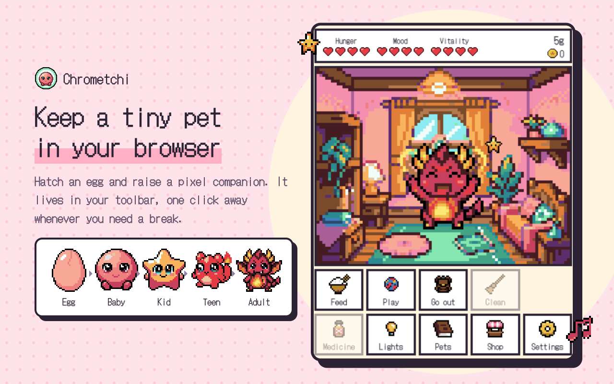
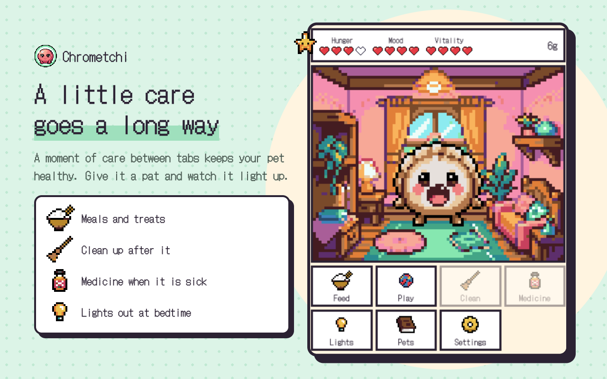
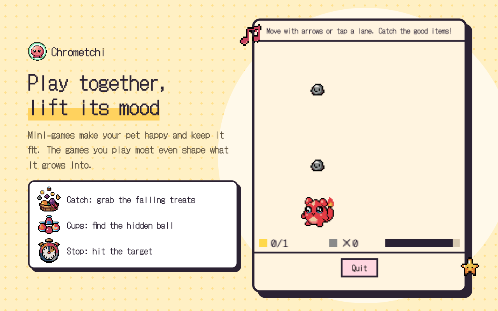
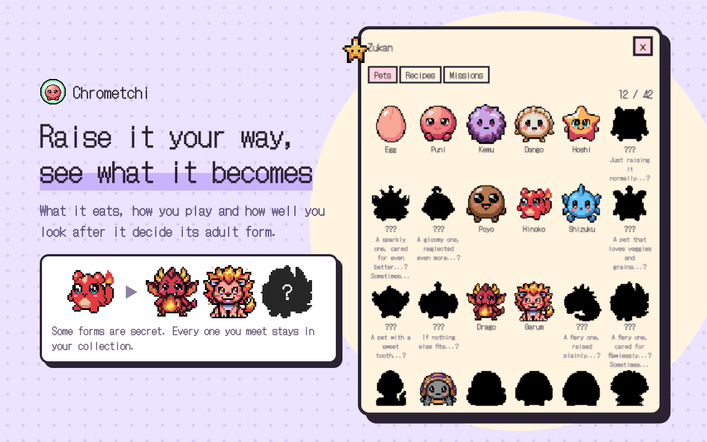
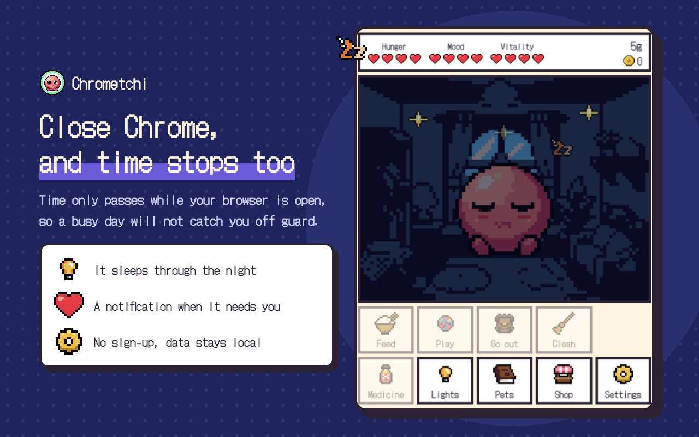

# Chrometchi

A pixel-art virtual pet that lives in your Chrome toolbar. Hatch an egg, raise it through
its life stages, and discover every form it can grow into.

Website: https://mkontani.github.io/chrometchi/



| | |
| --- | --- |
|  |  |
|  |  |

Japanese versions are in [`screenshots/ja`](screenshots/ja). The store listing text (English and
Japanese) is in [`docs/store/listing.md`](docs/store/listing.md), and the privacy policy is in
[`docs/store/privacy-policy.md`](docs/store/privacy-policy.md).

## Features

- **Branching evolution** across five stages. How you care for your pet decides what it becomes, and some forms are secret.
- **Care**: meals and treats, mini-games (Catch, Cups, Stop), cleaning up, medicine, lights out, and petting. Only rice and candy are free; everything else comes from the pantry.
- **Outings**: fishing, hunting and gathering (three trips each a day) and a small farm fill the pantry.
- **Cooking**: put up to four ingredients in the pot to discover 12 recipes; found recipes stay in the recipe book.
- **Coins and missions**: coins come from each generation's send-off, zukan milestones, missions (cleaning, playing, feeding, outings, harvests, cooking) and selling ingredients in the shop.
- **Rooms**: switch between eleven rooms from the decorate screen; new rooms come from rewards.
- **Time only runs while Chrome is open.** Your pet sleeps at night (configurable) and needs the lights off.
- **Warnings before death**: notifications and an in-popup banner tell you when life is in danger.
- **Zukan**: a collection of every form you have discovered, memories of past pets, your recipe book and your missions.
- **Walks on web pages** (optional): your pet strolls along the bottom of the pages you browse. Click it to hear how it is doing, drag it aside, or hide it on a site. Site access is asked for only when you turn this on.
- English and Japanese, optional chiptune sound effects (off by default).

## Install from source

```bash
npm ci
npm run build
```

Then open `chrome://extensions`, enable **Developer mode**, click **Load unpacked**, and select
`.output/chrome-mv3`.

## Development

Built with [WXT](https://wxt.dev), TypeScript and Preact.

| Command | What it does |
| --- | --- |
| `npm run dev` | Start WXT dev mode with hot reload |
| `npm test` | Run unit tests (Vitest) |
| `npm run test:coverage` | Unit tests with the 80% coverage gate |
| `npm run e2e` | Build and run Playwright extension tests |
| `npm run lint` | ESLint |
| `npm run typecheck` | TypeScript type check |
| `npm run zip` | Package `.output/*-chrome.zip` for release |
| `npm run screenshots` | Regenerate the store screenshots and promo tiles in `screenshots/{ja,en}` |

Before the first e2e run: `npx playwright install chromium`.

## Credits

Pixel art generated with PixelLab.
