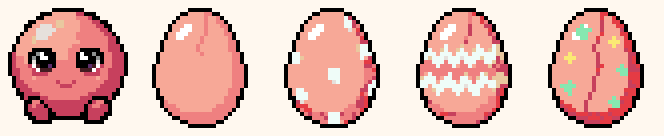

# Chrometchi art style guide

Style A: retro pop, 32×32, thick black outline, flat colors. Everything in the popup (characters, UI and backgrounds) uses this one style.

## Approved anchors (Gate A)



From left: `baby_puni`, then the egg patterns `plain`, `dots`, `zigzag` and `stars`.

- `src/assets/sprites/baby_puni/idle0.png` is the reference for every character. New sprites should match its outline weight, eye size and level of shading.
- `src/assets/sprites/egg/<pattern>/idle0.png`: all four patterns were adopted. The egg shows `EGG_PATTERNS[(generation - 1) % 4]` (`src/data/eggs.ts`), so each new egg has a different shell.

## Palette


There are 32 colors, listed in `src/assets/palette.json`. Every sprite is snapped to this palette with `reduce_colors(palette_image=docs/art/palette.png)`, and `npx tsx scripts/art/check.ts --palette <files>` must pass.

## Characters

Generation params: `create_image_pixen(width 32, height 32, no_background true, outline 'single color black outline', detail 'low detail', direction 'south', view 'side')`.

Prompt template (fill `{motif}` from `FORMS`):

```
cute {motif}, chibi virtual pet creature, round simple body, big sparkly eyes, rosy cheeks, front view, full body, centered, thick black outline
```

Poses come from `edit_image_pixen` on the approved `idle0` (seed 1, retry with 2 and 3). Snap the character's `idle0` and its 5 poses to the palette together in one `reduce_colors` call.

`idle1` is made in code, not by AI (Gate C): `npx tsx scripts/art/idle1.ts squash <idle0> <idle1>`. It removes the most redundant row in the lower body, so the top sinks 1px while the feet stay put. AI-made `idle1` frames came out either the same as `idle0` or with a different silhouette, which flickers when the frames alternate every 500ms.

| pose | description |
|---|---|
| happy | same character overjoyed, eyes closed as happy arcs, mouth open smiling, arms up |
| eat | same character eating, mouth wide open chewing |
| sick | same character sick, pale tint, swirly dizzy eyes, sweat drop |
| sleep | same character asleep, eyes closed lines, relaxed, slightly slumped |
| sad | same character sad, teary eyes, frowning, drooping |

## Roaming (Plan 3)

Every form except the egg has `side.png` (right-facing profile) and `walk0`–`walk7` (an 8-frame loop). The roaming view mirrors them when the pet heads left, and turns the pet to face front (`idle0`/`idle1`) when it stops.

- **Move the way the body works** (owner feedback at the walk gate). Each form has a gait in `src/roam/gait.ts`, and its loop is drawn in that gait:
  - walk: on two feet;
  - trot: on all fours (forms whose hands touch the ground);
  - hop: round bodies;
  - crawl: legless forms on the ground;
  - float: legless or winged forms.
- **Loops stay in place.** The code moves the sprite across the page and adds float lift, bob and hop height. Art that travels inside its frame drifts off the edge and gets cut.
- Side view: `edit_image_pixen` on `idle0` (seed 1, retry with 2 and 3), posed for the gait (on all fours, wings spread with legs tucked, no legs and low on the ground…). Name the signature parts (horns, crown, shell, halo) so they survive.
- Loop: `animate_image_pixminimax(frame_count 8, direction 'east', view 'side')` from the side view. Describe the body's motion only, never travel: "slithering forward" and "oozing forward" drifted out of the frame on two seeds, while "undulating in place … no forward movement" stayed put. For winged flyers, "the body stays level and upright … no turning, no spinning" stopped them tumbling.
- Snap `idle0`, `side` and the 8 frames to the palette together in one `reduce_colors` call. Never write `idle0` back.
- Other tested loop wording:
  - trot: `trotting in place on all four legs, legs moving in a diagonal walking gait, … staying centered in the frame like on a treadmill`;
  - hop: `squashing and stretching in place as if hopping … staying on the ground in the center of the frame`;
  - float, legless: `floating in place, hovering with a gentle up and down bob …, no legs, no walking`.
- **The side view keeps the front's shape** (owner review of all 41 forms). `child_mochi`, `adult_unicorn` and `adult_nexus` were remade:
  - `child_mochi` had become a sitting cat. Its new side view says "round like a ball (not a cat, not sitting)".
  - `adult_nexus` had lost its ring and grown feet. Its new side view names the ring and says "no legs, no feet".
  - `adult_unicorn` had a small head and long legs, unlike its chibi front. Editing `idle0` stood it on two legs. Editing the old `side.png` ("make it a cute chibi baby pony: a much bigger round head as big as the body … still standing on all four legs") kept all four legs.
  - Round bodies (mochi, poyo) got a dark vertical line down the middle of the body on every seed. A second `edit_image_pixen` on the side view removed it: "remove the dark vertical line in the middle of the body so the body is one smooth round … ball, keep the tiny feet at the very bottom".
  - Hop loops can still drift: one of two poyo seeds slid out of the frame, and one mochi seed lost its ear mid-hop. Make 2–3 loops and pick one.

## Stage 5 art fixes (Gate R1)

The 41 forms made on 2026-11-06 had weak frames. They were fixed before stage 5 copied them in. Most fixes are hand edits on the palette, made by scripts in `.superpowers/art-work/2026-11-06/fixes/`. That folder is git-ignored scratch on the owner's machine, beside the forms. `fix.sh` rebuilds every fixed frame from the originals, which are kept as `<frame>_old.png`.

- **Swirly sick eyes are hand-drawn.** 23 `sick` frames had only a pale face and tears.
  - `edit_image_pixen` can't draw swirls at 32 px. Three edits from `idle0` gave no spirals (pumpkin's came out as square beige eyes): the sick prompt plus "draw both eyes as clear black spiral swirls … keep the same body colors only a little paler, same shape, no tears". Three eyes-only edits on the old `sick` frame changed nothing.
  - So `eyes.cjs` paints each eye over with a stamp: a black clockwise spiral, 6x6, 6x5 or 5x5 to fit the old eye, white inside and mirrored on the right eye. The pale tint and the tears stay.
- **Happy poses.**
  - `idle0` edits, seed 1, the happy prompt plus the fix:
    - dandelion: "Both eyes fully closed as upward curved happy arcs, no open eyes, same white fluffy colors";
    - ame: "arms up" replaced by "Keep the two twisted candy wrapper ends on its left and right sides exactly as they are, they are wrapper ends and not arms, no arms, same round candy shape";
    - obake: "Still holding its tiny orange lantern in front of its body, keep the lantern".
  - kingyo: an `idle0` edit turned it into a standing fish. An edit of the old `happy` worked instead: "Change only the eyes: close both eyes as upward curved happy arcs like ^ ^, no open eyes, keep everything else exactly the same".
  - bunny: both kinds of edit kept its eyes open, so the arcs are drawn by hand. Each eye is a 3 px top with one pixel below each end.
  - Each new pose was snapped with `idle0` in one `reduce_colors` call.
- **Colours the snap lost.** These are exact colour maps (`recolor.cjs`) over every frame of the form. `idle1` was remade with `idle1.ts squash`.
  - dandelion: each grey is one step lighter (`#e6e0dc`→`#ffffff`, `#8d9191`→`#e6e0dc`, `#56595b`→`#8d9191`), so the puff is white as in the source.
  - drone: the source's lavender body is back (`#8d9191`→`#c9a3e6`, `#56595b`→`#5d2e6c`, highlights one step lighter). The navy underside stays. Its `sick` was already lavender, so it goes one step paler.
  - awa: the grey blotch (`#8d9191`) becomes the bubble's `#c9a3e6`.
  - balloon: the poses, side and walk had snapped to salmon `#ef8080`. They now use `idle0`'s pink `#f58fb0`. Its `sick` was nearly white and stood on legs. It is now pink with a lavender sick shade, and has `idle0`'s string (rows 27–31).
  - seal `happy`: the `#e6e0dc` body becomes `#ffffff`, like its other frames.
- **Side views bluer than the front** (side and walk):
  - stormbird: `#3d82ba`→`#8d9191` and `#c9a3e6`→`#ffffff`. It is a white bird with grey shading, like its front.
  - jellyfish: `#3d82ba`→`#c9a3e6`, `#65c4fb`→`#f58fb0`, `#8debf0`→`#ffffff`. The bell is pink and lavender again.
- **tane** (side and walk): the snap had made the whole body the cap's dark brown. The 9 rows under the cap band are back to the front's light brown `#b4794d`, with a 1 px dark rim.
- **kaminari floats** (side and walk): `nolegs.cjs` cuts the legs off below the body's closed bottom edge.
- **Check the snap against `idle0`.** When the source sits between two palette colours, the snap can turn a whole frame grey or salmon. Compare each frame's mean colour with `idle0`'s before approving (`meancol.cjs`).
- **Copying into the game.**
  - Copy only the 16 frame names from each form folder: `idle0`, `idle1`, `eat`, `happy`, `sick`, `sleep`, `sad`, `side` and `walk0`–`walk7`.
  - Skip every `*_old.png`.
  - Read the `squashRow` of dandelion, drone and awa from their remade `idle1`, not from the old one.
- **Left weak on purpose** (accepted at Gate R1):
  - hedgehog `walk5` clumps;
  - yuki's side-view legs are stubby;
  - the stamped spirals all look alike;
  - balloon `sick` reads as sick only through its eyes and the lavender;
  - drone's body is the lighter lavender;
  - seal `sad` has a speckle.

## Effects (care)

Effects play on the popup stage after feed, clean, medicine and lights (`src/ui/effects/`). The owner approved all of them at Gate E (2026-11-04).

- **Timing** lives in one pure timeline per care: `src/ui/effects/{feed,clean,medicine,lights}.ts`. Each one says what the stage shows at a given millisecond. Positions on the stage are in `src/ui/effects/layout.ts`.
- **Every effect moves in whole display pixels.** Props sit on even x and y, scale only by whole numbers, and step instead of gliding. The pet only shakes by ±4px. `src/ui/effects/timeline.test.ts` checks this for every effect.
- **Reused art:** the 6 foods, `pill`, `sparkle`, `sweat`, the `lights` button as the switch, and the `clean` button at 4× as the broom.

- **Bitten foods** come from a script, never from AI: `npx tsx scripts/art/bite.ts <1|2> src/assets/ui/icons/food_<id>.png src/assets/ui/food/<id>_bite<n>.png`.
  - It cuts round bites from the right side and drops any piece the bite leaves floating.
  - It outlines the new edge in `#000000`.
  - A new food only needs the script run twice.
- **Crumbs, dust and star** (`crumb`, `dust0`–`dust2`, `star`, 16×16) are drawn as exact pixel maps on the palette, not by AI.
  - The prompt `cute pixel … effect` gave even crumbs and dust a face on 9 of 9 tries.
  - The dust puffs are unions of circles, with a 1px black outline, a white highlight on the upper left and `#8d9191` shade on the lower right.

## Pantry and outings

Art for the pantry, the outing games and the farm row (`src/assets/ui/outing/`, shown at 2x or more; the owner reviews it at Gate F).

- **No faces on food or props.** `create_image_pixen` gave the round bush a face on 3 of 3 tries, so the bush is drawn by hand (below). The fruit icon (an apple in front of a bunch of grapes) is hand-drawn on the palette, because PixelLab gave the apple a face on 3 of 3 tries; the owner picked it after Gate F. The egg food was hand-drawn (Task 1).
- **Settings for every piece:** `no_background true`, `outline 'single color black outline'`, `detail 'low detail'`, 3 candidates each. Snap the pick with `reduce_colors` and `docs/art/palette.png`, then run `npx tsx scripts/art/check.ts --palette --size <WxH> <files>`.
- **Pieces, sizes and prompts:**
  - `float` (16x16): `a red and white fishing float, cute pixel icon, thick black outline, no face`
  - `grass` (32x32): `a tuft of tall green grass, cute pixel art, thick black outline, no face`
  - `bush` (32x32): prompt `a round green bush, cute pixel art, thick black outline, no face`; all 3 results had faces or were trees, so the final art is a hand-drawn pixel map on the palette (union of circles, 1px black outline, `#86e7b0` light upper left, `#317352` shade lower right).
  - `sprout` (16x16): `a small green sprout in soil, cute pixel icon, thick black outline, no face`
  - `sprout_wet` (16x16): not AI. `sprout` with every color mapped by a script to the next darker shade of the master palette (leaves `#fbe974` to `#edc24c`, soil `#b4794d` to `#7a4a2a` and `#7a4a2a` to `#441c21`), so it reads as wet soil. Outline and transparency are untouched.
  - `can` (16x16): `a small blue watering can, cute pixel icon, thick black outline, no face`
  - `boar` (24x24): `a cute round baby wild boar, side view, cute pixel art, thick black outline, simple` (pick: seed 33 of 3)
  - `chicken` (24x24): `a cute round white hen chicken, side view, cute pixel art, thick black outline, simple` (pick: seed 11 of 3)
  - `hud_fish`, `hud_meat`, `hud_nuts`, `hud_bush` (16x16, counter icons in the outing games): not AI. Each is the 32x32 food icon (or `bush`) halved by a script (a 2x2 block is kept when 2 of its 4 pixels are opaque, takes its most common non-black color, then the outline is redrawn as a clean 1px `#000000` line), so the black outline stays intact at native size.
- **Hunting pop is a cute animal, never hurt.** A small round boar (meat) or hen (egg) pops out of the grass tuft (owner decision at Gate G). Animals may have eyes (they are creatures, not food or props), but never look scary: no sharp tusks, no angry face, no blood, no injury. Catching one just sends it back into the grass with the star burst; never draw it falling, hurt, crying or dropping meat. Art is drawn at native size (24x24 in a 24x24 box); do not scale it.
- **Where they show:** `float`, `grass`, `bush`, `boar` and `chicken` in the games, `hud_*` in their counters (`src/outings/*/render.ts`); `sprout` while a crop grows (`sprout_wet` once it is watered) and `can` on the water button in `OutingPanel`.

## Dishes

The 11 dishes and the mystery dish (`src/assets/ui/icons/food_<id>.png`, 32x32, plus `src/assets/ui/food/<id>_bite{1,2}.png` from `bite.ts`).

- **Settings for every icon:** `create_image_pixen`, 32x32, `no_background true`, `outline 'single color black outline'`, `detail 'low detail'`, 3 candidates (seeds 1 to 3). Prompt: `<dish words>, cute pixel food icon, thick black outline, no face`.
- **Snap:** nearest color on `docs/art/palette.png`, keep only the largest piece, and force every edge pixel to `#000000` (done by a local script, same result as `reduce_colors`). Then `check.ts --palette --size 32x32`.
- **Dish words and picks** (steak, onigiri, seafoodbowl, friedshrimp, hamburg, stirfry and mushroomsoup were redone at Gate H on 2026-11-05 after the owner said they looked off; the prompts below are the redo prompts, each ending `cute pixel food icon, thick black outline, no face`):
  - `steak`: `a grilled steak with dark grill marks and a small fat edge on a white oval plate with a sprig of green` (seed 11)
  - `acquapazza`: `a whole fish simmered in a shallow pan with tomatoes and greens` (seed 1)
  - `onigiri`: `a white triangle shaped onigiri rice ball with a black nori strip across the bottom and a pink salmon flake on top` (seed 14). It must read differently from `food_rice` (a plain triangle with a nori band): the pink salmon on top is the difference.
  - `omurice`: `omelet rice, a yellow omelet over rice with a red ketchup zigzag line` (seed 1). The ketchup is a zigzag only; never draw it as eyes or a mouth.
  - `seafoodbowl`: `a simple rice bowl seen from above topped with pink fish slices and one shrimp` (seed 11)
  - `friedshrimp`: `two fried shrimp tempura with light brown bumpy breaded coating and red tails on a white plate` (seed 12). Golden breaded, never raw red.
  - `hamburg`: `a thick oval hamburg steak patty with glossy dark brown sauce on top on a white plate with a carrot piece` (seed 11)
  - `stirfry`: `stir-fried vegetables in a dark wok, light green cabbage, orange carrot slices, dark green peppers` (seed 12). Bite frames are cut from a copy without the pan handle area.
  - `mushroomsoup`: `a white bowl of creamy beige soup with mushroom slices on top, top view` (seed 12). No dots or marks that could read as eyes.
  - `fruittart`: `a small fruit tart with berries and apple slices` (seed 3)
  - `mystery`: `a bowl of odd purple stew with bubbles` (seed 2). The spoon tip is trimmed so it does not touch the corner, and loose bubbles are dropped by the snap.
- **Hand-drawn, not AI:** after the Gate H redo only `nutcookie` is hand-drawn (the redo picks are all PixelLab). `nutcookie` (two round cookies with nuts). All 3 candidates were a burger, muffins or a dark disc. It is a union of two circles on the palette (`#e9c89f` body, `#fbe974` light, `#b4794d` shade, `#7a4a2a` nuts). Its bite 1 cuts the front cookie; bite 2 is cut from a copy with only the back cookie, so no thin crescent is left.
- **No faces on food**, including ketchup or toppings. Fish may keep a plain dot eye, as the raw fish icon does.
- **The cooking pot** (`src/assets/ui/cook/pot.png`, 32x32, drawn at 2x by the cook effect): same settings as the icons, prompt `a small round cooking pot with a lid and two handles, cute pixel icon, thick black outline, no face` (seed 2 of 3; none had a face, seed 3 sat on a fire). Snapped and edge-fixed like the icons. The steam is not new art: it reuses the dust puffs `dust0`-`dust2`.

## Coins and shop

Two 16x16 icons (`src/assets/ui/icons/coin.png` and `src/assets/ui/icons/shop.png`). The coin sits in the status bar at 16px. The shop is the action button, shown at 32px like the other action icons. Approved by the owner at Gate J (2026-11-07).

- **Settings:** `create_image_pixen`, 16x16, `no_background true`, `outline 'single color black outline'`, `detail 'low detail'`, 3 candidates (seeds 1 to 3). Snap with `reduce_colors` and `docs/art/palette.png`, then `check.ts --palette --size 16x16`.
- **`coin`:** prompt `a shiny round gold coin with a small star stamped in the middle, cute pixel icon, thick black outline, simple, front view, no face`.
  - Pick: seed 1, with its outline and silhouette (a 14x13 octagon).
  - Seed 2's dark star read as a little face, and seed 3 was a 10x10 coin with no star. Seed 1 had no star either: its face snapped to a muddy orange blob.
  - Hand fix: the inside of seed 1 is repainted in the settings icon's gold, with a stamped star in the middle (5 rows, 6 wide). The colors are `#fbe974` light on the upper left, `#edc24c` body, and `#b8862a` shade on the lower right and for the star. The black outline is untouched.
- **`shop`:** prompt `a tiny market stall with a pink and white striped awning, cute pixel icon, thick black outline, simple, front view, no face`.
  - Pick: seed 1, a striped awning over a wooden counter.
  - Seed 2's dark opening with gray teeth read as a mouth. Seed 3 was small and cluttered.
  - Hand fix: the snap turned the awning's hot pink into `#ef8080` salmon. That one color is mapped to `#f58fb0` pink, so the awning stays pink and white as the prompt asks. Nothing else changed.

## Rooms

The 11 rooms (`src/assets/ui/bg/<room>_{day,night}.png`, 88x68, opaque, drawn at 4x on the 352x272 stage). Each is an empty version of the picture it replaces. The walls, floor, windows and the room's identity stay, and the free-standing furniture and clutter are gone, so stage 3's furniture has space. The sources were the old `room_day` (for `home`) and the 2026-11-06 room pictures (for the other 10).

- **Slot areas kept plain** (room px; stage 3 may still move them): wall L (6,6,14x14), wall R (68,6,14x14), ceiling (28,0,32x10), floor L (3,39,18x19), floor R (67,39,18x19), rug (32,51,24x12). Outside rooms (garden, beach, forest, snowfield) keep only the floor and rug areas plain.
- **Day:** `edit_image_pixen` on the source day picture at 88x68, seeds 1 to 3.
  - Inside: `the same room with all the furniture and clutter taken out, keep the walls, the floor, the windows and the <identity words>, plain empty wall areas on the upper left and upper right, plain empty floor on the lower left and lower right, simple, flat colors, no characters`
  - Outside: `the same place with the clutter taken out, keep the sky and the <identity words>, trees or scenery only at the far edges, plain open ground on the lower left, lower right and in the middle, simple, flat colors, no characters`
- **Night:** `edit_image_pixen` on the chosen day picture, seed 1. All 11 seed-1 nights were kept.
  - Inside: `the same room at night, lights off, dark blue tones, soft moonlight through the window, keep the same layout`
  - Outside: `the same scene at night, dark blue sky with stars and a moon, dark blue tones, keep the same layout`
  - Brighten a night before the snap when most of it would snap to `#0f0b26`. Each channel becomes `c*mul+add`: cabin x1.4+6 (78% to 29% near-black), washitsu x1.3+5 (62% to 41%).
- **Snap:** each day/night pair goes through one `reduce_colors(palette_image=docs/art/palette.png)` call together. Check with `npx tsx scripts/art/check.ts --palette --opaque --size 88x68 src/assets/ui/bg/*.png`. Rooms are opaque, so they need `--opaque`.
- **No characters or faces.** Watch windows and pictures: all 3 sweets seeds kept a crowned figure with eyes in the window.
- **Picks:**

| room | identity words | pick | notes |
|---|---|---|---|
| home | pink walls, wooden floor and round window | s1 | s2 lost the curtains; s3 kept the ceiling lamp |
| garden | white picket fence and blue sky | s2 | s1 turned the lawn to dirt; s3 kept bushes in the floor corners |
| beach | sea and sky | s1 | the palm trunk stays in floor R (it is the beach) |
| forest | soft green trees and grass | s1 | s2 and s3 became an open meadow; the roots reach the top of floor L and R |
| sweets | pastel walls and checkered floor | s3 | the shelves are gone; s2 had bunting in the ceiling slot. Hand fix: the window's crown and eyes are repainted as the curtain stripes and a snowy peak |
| snowfield | see notes | r3 | all 3 seeds with `snowy hills and sky` turned the snow into sand. Retry (seeds 1 to 3) with the outside prompt changed to `keep the sky and the white snow covered ground, snowy pine trees and snowy hills, …, plain open white snow on the lower left, …`; r3 has pines at the edges |
| castle | stone walls, arched window and red carpet | s1 | s2 and s3 lost the red carpet. Hand fix: the snap turned the carpet brown, so its pixels are set to `#c7405d`, the old castle's carpet color |
| washitsu | shoji doors and tatami floor | s1 | s2 lost the shoji and tatami. Hand fix: the hanging lantern in the ceiling slot is painted out with each row's main ceiling color |
| space | round porthole with stars and lavender metal walls | s1 | Hand fix: the ceiling light panel is painted out in the ceiling gray, and the two panel edge lines are redrawn |
| cabin | log walls and snowy window | s3 | the fireplace is gone; s1 left an empty frame and a rug outline |
| library | wooden walls and a window | s1 | the bookshelves are gone; an empty board frame stays on the back wall |

### Slot exceptions for stage 3

Stage 3 must place its slots around these:

- The beach palm trunk is in floor R.
- The forest roots reach floor L and floor R.
- The library window reaches wall R.
- Because of the perspective, the floor slots in castle, washitsu, space and home partly sit on wall or door pixels.

Stage 3 handles each one in the slot table under "Furniture".

### The もようがえ icon

`src/assets/ui/icons/decorate.png`, 16x16, an action button shown at 32px like the shop.

- **Settings:** the same as the coin and shop icons. Prompt: `a small cozy pink armchair, cute pixel icon, thick black outline, simple, front view, no face`.
- **Pick:** seed 1. Seed 2 had two dark dots on the backrest that read as eyes, and the marks on seed 3's backrest read as a mouth.
- **Hand fix:** the snap turned the pink into `#ef8080` salmon, which is mapped to `#f58fb0` pink, as for the shop. The two `#c7405d` tuft dots at the top of the backrest are repainted pink so they cannot read as eyes. The outline was already a closed `#000000` line.

## Furniture

The 28 items are in `src/assets/ui/decor/<id>.png`. Each is 24x24 or 32x32 (as `DECOR` says), on the palette, with a transparent background. The owner reviews them at Gate N.

- **Source:** the 2026-11-06 art batch, already snapped to the palette. Both checks pass: `npx tsx scripts/art/check.ts --palette --size 32x32` on the 16 large items and `--size 24x24` on the 12 small ones.
- **No faces.** All 28 were checked at 4x. The fishbowl's fish keeps a plain dot eye, as the raw fish icon does.
- **Baked-in shadows:** the cushion and the armchair have a pale floor shadow in their art. It shows under them on the floor.

### Drawing

- **Scale:** 2x, the same as the food. 32 px art is drawn at 64 px, and 24 px art at 48 px.
- **Alignment in the slot:**
  - floor items are bottom-centred;
  - wall and rug items are centred;
  - ceiling items are top-centred.
  - This per-slot-kind alignment is the owner-approved rule (Gate N, 2026-11-07). It replaces spec 7.2's "bottom-centred for all".
- **Layers, back to front:** room picture → wall and ceiling → rug → pet → floor.
- **Night:** while the pet sleeps (the night picture), every item gets `filter: invert(1) sepia(0.6) invert(1) brightness(0.6)`.
  - The filter pulls each color toward a moonlit blue, then dims it. White becomes `#999999`, and the pink armchair becomes a muted mauve. This sits close to the night pictures' tone, while the items still read.
  - The gate sheets apply the same filter with the spec's matrices, so the popup matches them to within rounding. The result is the same whether or not the browser clamps between steps: `invert` turns the only out-of-range step (sepia above 1) into the clamp at 0.
  - Rejected: `brightness(0.55) saturate(0.8)` left the reds warm against the blue room. `sepia() hue-rotate()` turns each item's own colors (the pink armchair went teal), and it depends on the browser's clamping.
  - The lights-off darkness still covers everything.

### Slots

Slot rectangles are in stage px (x, y, w×h), in `ROOM_SLOTS` (`src/data/slots.ts`). `src/data/data.test.ts` checks these rules:

- every value is a multiple of 4 (one room pixel), so items drawn at 2x land on whole display pixels;
- every slot lies on the stage;
- every slot is wide enough for its widest item: 48 px for wall slots, 64 px for the others;
- floor and wall slots are also tall enough for their tallest item;
- no two slots in a room overlap;
- floor slots never overlap the pet's box (x 112–240, y 100–228).

The tuning also follows these:

- Floor items stand with their bottom row on floor pixels.
- Floor slots end at y 232. That is just above the poops (`right: 8px; bottom: 8px`; up to 4 poops cover x 204–344, y 232–264), so a floor item never hides a poop.
- Wall items hang on a plain wall, never across a corner line, a window or a door frame.
- The ceiling (112, 0, 128×40) and the rug (128, 204, 96×48) are the same in every room. "start" in the table means the stage-3 starting rectangle: floor L (12, 156, 72×76), floor R (268, 156, 72×76), wall L (24, 24, 56×56), wall R (272, 24, 56×56).

| room | wall L | wall R | floor L | floor R | why |
|---|---|---|---|---|---|
| home | (48, 48, 56×56) | (240, 48, 56×56) | start | start | The clock and the picture sat across the purple corner lines. They now hang on the back wall, between the corner and the curtain (a 48 px plain strip on each side), below the ends of the curtain rod. The floor reaches the slots' bottom row, so the floor slots stay. |
| sweets | (0, 24, 56×56) | (296, 24, 56×56) | start | start | The side walls are plain cream, so the wall items sit there, clear of the pink corner lines. The back wall has the door and the windows. |
| castle | (4, 24, 56×56) | (296, 24, 56×56) | (48, 156, 64×76) | (240, 156, 64×76) | The wall items move onto plain stone, off the arch's dark edge. At the bottom row the teal floor only spans room x 11–29 and 58–75. The floor items move in beside the pet and stand on the floor in front of the arch columns; at the start, their left part stood on stone. |
| washitsu | (72, 40, 48×48) | (232, 40, 48×48) | (48, 156, 64×76) | (240, 156, 64×76) | No plain wall is big enough: the upper corners are ceiling beams. The wall items hang centred on the pink transoms (ramma) above the shoji, from the beam. The tatami spans room x 10–75 at the bottom row. The floor items move in, off the window and the gray wall panel. |
| space | start | (268, 24, 56×56) | (48, 156, 64×76) | (240, 156, 64×76) | The picture moves 4 px left to sit inside its wall panel, clear of the diagonal seam. The blue floor only spans room x 13–74 at the bottom row. The floor items move in, off the lavender wall. |
| cabin | (4, 72, 56×56) | (288, 72, 56×56) | (24, 156, 72×76) | (256, 156, 72×76) | At the start, the wall items sat on the sloping roof logs. They now hang on the plain orange side-wall panels beside the windows. The floor only spans room x 7–80 at the bottom row, so the floor items move in by 12 px each. |
| library | (4, 24, 56×56) | (204, 52, 48×48) | (24, 156, 72×76) | (244, 156, 64×76) | Wall L moves onto the plain left side wall, off the corner. The window fills the right side wall, so wall R hangs inside the empty board frame on the back wall. Floor R ends at x 308, left of the window frame (room x 77). Floor L moves in, off the wall. |
| garden | – | – | start | start | Open lawn. The trees stay above the items. |
| beach | – | – | start | (240, 156, 64×76) | The palm trunk fills room x 72–83 down to row 58. Floor R moves left, beside the pet. 64 px items still cover the trunk's left outline by a few px: there is no room further left. |
| forest | – | – | (48, 156, 64×76) | (240, 156, 64×76) | The roots reach row 49 at room x 0–14 and row 48 at x 73–86. The floor items move in beside the pet, onto open grass. Full-width items touch the root tips by 1–3 px. |
| snowfield | – | – | start | start | Open snow. |

## Accessories

The 25 items are in `src/assets/ui/acc/<id>.png`. They are on the palette, with a transparent background. The owner reviews them at Gate P, together with the forms' points.

- **Sizes** (as `ACCESSORIES` says):
  - 20x20: strawhat, wizardhat, headphones and scarf;
  - 24x24: flowercrown;
  - 16x16: the other 20.
- **Source:** the 2026-11-06 art batch, already snapped to the palette. Five items were redrawn: the heart glasses and the necklace in Task 3, then the scarf, necklace and flower crown again at Gate P (below). `npx tsx scripts/art/check.ts --palette --size <N>x<N>` passes for each size group.
- **No faces.** All 25 were checked at 4x. The tiara's centre is a heart gem, not a face.
- **Scale:** 4x, the pet's pixel size, so an item's pixels match the pet's.

### The two redraws

Two items from the batch did not read at 16 px. The heart glasses did not look like hearts, and the necklace was a plain ring.

- **Settings:** `edit_image_pixen` on the old 16x16 art, seeds 1 to 3. All six were snapped in one `reduce_colors(palette_image=docs/art/palette.png)` call, then checked with `check.ts --palette --size 16x16`.
- **`heartglasses`:**
  - Prompt: `a pair of pink heart-shaped sunglasses, the two lenses clearly heart shaped, cute pixel icon, thick black outline, item only, front view, no face`.
  - Pick: seed 3. Its two pink lenses have a notched top and a pointed bottom, joined by a red bridge.
  - The other seeds: seed 1 was nearly the old art, with flat-bottomed lenses. Seed 2 had heart shapes, but they were red, with purple pixels left in one lens.
  - Hand fix: the `#c7405d` shade pixels are made the same on both hearts: the tip, plus the pixel above it and to the right. The outline was already closed.
- **`necklace`:**
  - Prompt: `a small pearl necklace with a pink heart pendant hanging at the bottom, cute pixel icon, thick black outline, item only, front view, no face`.
  - Pick: seed 1, the cleanest pearl chain. Each seed added a pendant, but none was heart-shaped:
    - seed 1: a rounded drop;
    - seed 2: a mottled gem;
    - seed 3: a soft drop, on a chain with several open outline pixels.
  - Hand fix: rows 10–15 are repainted as an 8-px heart, hung from the chain's black bottom line:
    - `#f58fb0` body;
    - one `#ffffff` highlight on the left lobe;
    - `#c7405d` shade down the lower right.
  - Hand fix: one chain pixel on the right at row 8 had no outline. It is moved in by 1 px and outlined in `#000000`, mirroring the left side.
  - This necklace was replaced at Gate P (below).

### The Gate P redraws (shorter)

At Gate P (2026-11-07) the owner approved the other 22 items and asked for three of them to be shorter:
- the scarf (16 px) and the necklace (15 px) hung their loops down the body and past the feet;
- the flower crown was a ring that stood above the head.

Each item is now 8 px tall. The replaced art is kept in `.superpowers/sdd/2026-11-07-dressup/art/` as `scarf_old.png`, `necklace_old2.png` and `flowercrown_old.png`.

- **Settings:**
  - `create_image_pixen` for the scarf (20x20) and the flower crown (24x24), with `no_background true`, `outline 'single color black outline'` and `detail 'low detail'`;
  - `edit_image_pixen` for the necklace, on its Task 3 art (16x16);
  - seeds 1 to 3 each;
  - each size group snapped in one `reduce_colors(palette_image=docs/art/palette.png)` call.
- **No seed came out short enough.** At 20 and 24 px, Pixen fills the canvas: all three scarves were 16–18 px tall, all three flower crowns were full rings 20–22 px tall, and two of the three necklaces kept the long loop (13 and 15 px). So each pick is cut down by hand on the palette:
  - the cut is drawn as fill pixels;
  - a 1 px `#000000` outline is added around every fill pixel's sides;
  - the result is checked for one piece, a closed black edge, and `check.ts --palette --size <N>x<N>`.
- **`scarf`** (20x20, now 18x8):
  - Prompt: `a short red and white striped knit scarf wrapped once around a neck, seen from the front, only a small knot and a very short tail, cute pixel icon, thick black outline, item only, no face`. This is the owner's prompt, with "red and white" added to keep the old stripes.
  - Pick: seed 3, the cleanest red and white knit.
  - Hand cut: a 3-row band round the neck, a knot right of centre, and a 2-row tail. It uses seed 3's colours with diagonal knit stripes: `#e53b44` and `#ffffff`, with `#c7405d` and `#e6e0dc` on the shaded underside.
  - Why diagonal: a first cut with straight 2-px stripes put a white block at each raised end, and the two blocks read like eyes.
- **`necklace`** (16x16, now 14x8):
  - Edit: `make this necklace short like a choker that sits at the neck: one gently curved row of small pearls across the top, with a small pink heart pendant hanging just under the middle of the chain, total height about 7 pixels, wider than tall, item only, thick black outline, no face`.
  - Pick: seed 2, the only short choker. It has a U-shaped chain and a small heart, but is still 11 px tall.
  - Hand cut: the chain's raised arms are dropped. A gently curved pearl choker (`#e6e0dc` and `#ffffff`) now carries seed 2's heart unchanged: `#f58fb0`, a `#ffffff` highlight and `#c7405d` shade.
  - Seed 1 kept the old loop. Seed 3 kept a long loop with a smaller heart.
- **`flowercrown`** (24x24, now 20x8):
  - Prompt: `a flower crown band seen straight from the front, a row of small pink and yellow flowers with green leaves, wide and short, cute pixel icon, thick black outline, item only, no face`.
  - All 3 seeds were rings: round wreaths, the third with an oval hole.
  - Hand cut: the band is the flower row of the old crown (rows 2–9), a pink flower in the middle with yellow flowers and green leaves at each side. Row 9's fill is turned into the closing black line, so the band ends just under the flowers.
  - Why the old row: it is already pink and yellow flowers with green leaves, in the approved style. Seed 3's flower row is muddier and uneven.
- **No faces:** all three were checked at 12x.

### Anchors

Each item's `anchor` in `ACCESSORIES` (`src/data/accessories.ts`) is the point of its art that lands on the form's point for its place.

- **Measuring:** take the box around the item's opaque pixels, in pixel-edge coordinates, so that a full 16 px item spans 0–16. Then:
  - head items: the bottom-centre of the box;
  - face items: the centre;
  - neck items: the top-centre.
- **Set by hand:**
  - `headphones` (10,14), was (10,17): low on the ear cups. A bottom-centre anchor stood the headphones on top of the head. Now the band arches over the head and the cups' last 3 rows rest on its top. The cups are only 14 px across, so they can't reach the sides of a face. With 4 or 5 rows (anchor 13 or 12), the cups covered the top of the eyes on the forms with the shortest foreheads (young_fuwari, young_mebuki, adult_bear, adult_hippo).
  - `flowercrown` (12,15), 1 px above its bottom-centre (12,16), so the band's bottom row rests on the head instead of on its top line. At (12,14) it came close to adult_bear's eyes. The old ring was (12,19), set by hand from (12,22).
- **The Gate P redraws** are measured by the rule: `scarf` (10,5), was (10,2), and `necklace` (8,4), was (8,1).
- **Whole pixels:** a half pixel rounds up (flowerpin x 7.5 → 8, bell x 7.5 → 8, heartglasses y 8.5 → 9). This keeps the item on the pet's 4x pixel grid.
- **Where they are written:** the values are literals in the table. `src/data/data.test.ts` checks that each anchor is a whole pixel inside its item's opaque box.
- **On the stage:** the item's top-left is at `stage x = 112 + 4·ax − 4·ox` and `stage y = 100 + 4·ay − 4·oy`, where `(ax, ay)` is the form's point and `(ox, oy)` the item's anchor. This puts the item's anchor exactly on the form's point.

### Form points

Every form except the egg has a head, a face and a neck point in `FORM_ANCHORS` (`src/data/anchors.ts`). Each point is `[x, y]` in the form's 32 px art, in pixel-edge coordinates like the item anchors. A worn item's anchor lands on the point for its place.

- **One set of points for every pose, and idle1 sinks.** The happy, eat and sleep poses keep idle0's silhouette: they move 2 px at most, and that is mostly sparkles. No pose needed its own points.
- **The idle1 rule** (spec 8.2: worn items bounce with the pet):
  - `scripts/art/idle1.ts squash` makes idle1 from idle0 by removing one row low in the body. Every row above it sinks 1 px, and the feet stay put.
  - `FORM_ANCHORS` records that row as `squashRow`. The values were read from the sprites, by comparing each idle0 with its idle1, and are written as literals.
  - In idle1, a point with `y <= squashRow` is drawn 1 art px (4 stage px) lower, so the hat and glasses sink with the head and face. Points are pixel edges: edges 0 to `squashRow` move down one, and the edges below stay put. With today's points, the head point sinks on all 41 forms, the face point on 38 and the neck point on 17.
  - A point on the edge `y = squashRow` sinks too. That edge is the bottom of row `squashRow` − 1, which sinks; the removed row was below it. On baby_puni, young_poyo and young_hinoko the neck point is on that edge. If the neck item stayed put there, it would cover the gap row under the mouth in idle1 and touch the mouth every other frame.
  - The face points of child_mochi, adult_ufo, adult_salamander, adult_nexus and adult_grandpudding are on that edge as well, so their glasses sink with the upper half of the eyes.
  - Every other pose (happy, eat, sick, sleep and sad) is its own picture, approved at Gate P, and uses idle0's points.
  - A new or redrawn idle1 must still be idle0 with one row removed. Otherwise the data test fails, and the form needs its own idle1 points.
  - The check still is `.superpowers/sdd/2026-11-07-dressup/art/idle1-check.png`: child_kemu, adult_kraken and baby_puni in idle0 and idle1, wearing tophat + glasses + bowtie.
- **First values** came from a throwaway script on each `idle0`:
  - head: the topmost opaque row, 3 px down. Its x is the centre of the opaque columns in the top 3 rows.
  - face: the eyes are two clusters of near-black pixels inside the silhouette (no neighbour is transparent, so the outline doesn't count). They lie on about the same row, either side of the middle, in the top 65% of the body. The point is the centre of the box around both eyes.
  - neck: 3 px below the lowest eye or mouth pixel, at the face's x. A mouth is a small dark cluster within 5 rows under the eyes.
- **Hand check:** each form was drawn by the stage rule (4x, pet → neck → face → head) in idle0, happy, eat and sleep, wearing three sets:
  - tophat + glasses + bowtie;
  - crown + sunglasses + scarf;
  - flowercrown + heartglasses + necklace.

  Hats should sit on the head, glasses on the eyes, and neck items under the face.
- **Rules the check added:**
  - The head point goes on the head itself, not on what sticks out of it: antennae, sprouts, fins, crests, halos, ear tips or floating gems. The hat then covers them.
  - Between ears, the head point is 2–3 px below the top of the skull, not the ear tips.
  - When a face is turned to one side, its points follow its own eyes and head, not the middle of the art.
  - The neck point sits under the mouth, with a gap of 0–2 px, and a bow tie hangs at most 1 px below the feet.
  - Where the mouth is low (adult_tree, adult_griffin), the bow tie's wings come up beside the mouth, so the tie ends at the feet (Gate P).
- **Set by hand:** 33 of the 41 forms. The 8 forms the script got right are child_dango, child_hoshi, adult_turtle, adult_golem, adult_mole, adult_cyborg, adult_vampire and adult_pudding. `x,y` means generated → set:

| form | changed | why |
|---|---|---|
| baby_puni | neck 16,18 → 16,22 | the mouth is pink, so the script missed it |
| child_kemu | head 17,3 → 16,4 | a small tuft set the top row |
| child_mochi | head 16,5 → 16,7 | the ears set the top row; the hat now sits between them |
| young_kirari | head 16,4 → 16,10 | the crown spikes are above the head |
| young_kage | head 15,5 → 16,11; face 15,13 → 16,17; neck 15,16 → 16,22 | the fuse ring is above the body, and the glowing eyes aren't dark, so no eyes were found |
| young_poyo | neck 16,17 → 16,22 | the open mouth was too big for the mouth filter |
| young_hinoko | head 18,6 → 14,8; face 16,16 → 13,15; neck 16,26 → 13,21 | the face is left of centre; the ears and tail flame pulled the head right, and the tail's outline was taken for an eye |
| young_shizuku | head 17,3 → 16,8 | the fin tip |
| young_mebuki | head 16,4 → 16,10 | the sprout; 2 px below the top of the skull, so the headphones clear the eyes |
| young_fuwari | head 16,6 → 16,8; face 16,15 → 16,13 | the tuft; the wing lines were taken for eyes. The head point is 2 px below the top of the skull, so the headphones clear the eyes |
| young_gear | head 16,3 → 16,10 | the antenna |
| adult_dragon | head 16,4 → 16,6 | the crest between the horns |
| adult_beast | head 16,3 → 15,5 | the mane spikes; centred over the face |
| adult_salamander | head 16,5 → 13,10; face 16,14 → 11,17; neck 16,17 → 11,22 | turned left, with a flame crest; no eyes were found |
| adult_phoenix | head 17,3 → 11,5; face 17,13 → 10,15; neck 17,16 → 10,20 | turned left, with a flame wing on the right; no eyes were found |
| adult_serpent | head 16,3 → 15,4; neck 15,17 → 15,18 | centred over the face; under the head |
| adult_kraken | neck 16,20 → 16,22 | the dark red mouth was missed |
| adult_tree | head 16,3 → 16,5 | the canopy's top is uneven. The neck is back at the generated 16,23 after Gate P, so the bow tie ends at the feet |
| adult_griffin | neck 16,23 → 16,22 | the beak was missed; at Gate P the point moved up so the bow tie ends at the feet, with its wings beside the beak |
| adult_owl | head 16,3 → 16,5 | the ear tufts |
| adult_pegasus | head 16,3 → 16,4; face 16,13 → 16,14; neck 16,16 → 16,20 | the mane top; no eyes were found |
| adult_robot | face 16,13 → 16,12; neck 16,16 → 16,18 | no eyes were found; the neck is the seam under the head |
| adult_ufo | head 16,5 → 16,8 | the antenna light |
| adult_ghost | neck 16,17 → 16,20 | the blue mouth was missed |
| adult_alien | neck 16,17 → 16,23 | the beak-like mouth runs down to row 21 |
| adult_bat | head 16,4 → 16,7 | the ears |
| adult_unicorn | head 16,3 → 16,4; face 16,13 → 16,16; neck 16,16 → 16,22 | the horn; no eyes were found |
| adult_comet | head 17,5 → 15,5 | the starry tail pulled it right |
| adult_nexus | head 17,4 → 16,9 | the floating gems above the orb |
| adult_astra | head 16,3 → 16,7; neck 16,18 → 16,19 | the halo; the red pupils reach row 16 |
| adult_bear | head 16,3 → 16,4 | the ears set the top row |
| adult_hippo | neck 16,16 → 16,23 | under the open mouth |
| adult_grandpudding | head 17,4 → 16,7 | the crown on top |

- **Neck items and the feet** (idle0, final points):
  - The bow tie, the scarf and the necklace hang 8 px below the neck point. They reach at most 1 px below the feet, on 7 forms: child_hoshi, child_mochi, young_kage, young_gear, adult_ufo, adult_vampire and adult_comet.
  - The bell hangs 9 px, reaching up to 2 px below the feet on 17 forms.
  - The medal hangs 12 px, reaching 1–5 px below the feet on 34 forms.
  - The owner approved the bell and the medal as they are at Gate P.
  - Before Gate P, the scarf (16 px) and the necklace (15 px) hung up to 10 px below the feet; see the Gate P redraws.
- **Tests:** `src/data/data.test.ts` checks:
  - every form but the egg has points;
  - every point is a whole pixel inside the 32 px art;
  - for each form, the head point is above the face point, which is above the neck point;
  - a bow tie hangs at most 1 px below the feet of any form;
  - each idle1 is its idle0 with the rows above `squashRow` moved down one;
  - the scarf, necklace and flower crown are at most 8 px tall.

## Eggs

- **Eggs never have a face** (no eyes, mouth or cheeks). This is owner feedback from Gate A.
- Do not use the character template for eggs, because it adds eyes and cheeks. Even with "no face" in the prompt, `create_image_pixen` still drew a face on 4 out of 4 tries. Make egg variants with `edit_image_pixen` starting from `egg/plain/idle0.png`, with instructions like "add …, keep the same egg shape, … No face."
- `idle1` (the wobble frame) is also made in code: `npx tsx scripts/art/idle1.ts nudge <idle0> <idle1>` moves the whole shell 1px right. Shifting only part of the shell leaves a kink in the outline.

## Do / don't

- Do keep a 1px black outline around the whole silhouette, flat fills with at most one shade step, and a transparent background (`check.ts` rejects opaque corners and half-transparent pixels).
- Do review every candidate at 4× (128px, as in the popup) before approving it.
- Don't draw faces on eggs.
- Don't copy or closely imitate characters or names from existing franchises. Renamed examples: Akubiba, Horimo, Custa.
- Don't use fine detail or soft gradients. The old art looked coarse and cheap, and the goal is a simple, clean, cute Tamagotchi-like look.
