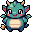

# Chrometchi 全面リニューアル 設計書

- 日付: 2026-11-03
- 対象: `chrometchi-extension`(Chrome 拡張 / Manifest V3)
- 状態: オーナー確認待ち(ビルダーチェック反映済み)

> 表記ルール: **【オーナー】** はオーナーが会話で決めたこと。**【判断】** は設計者(Claude)が任された範囲で決めたことで、ビルダーが理由を持って変えてよい。

---

## 1. 何を、なぜ作るか

Chrometchi はブラウザで卵から育てるバーチャルペット。現行版(v0.0.2)は約1,000行の素の JS で、オーナーの評価は次のとおり。

- 【オーナー】キャラのドット絵が粗くて安っぽい(16×16 の手書き SVG。輪郭線・陰影なし)
- 【オーナー】遊びが単調。Food と Play が1種類ずつしかない
- 【オーナー】使いづらい(実際、Clean / Heal は未実装で演出だけ。Restart が通常ボタンの隣にある。状態は小さな % 表示)

今回は**見た目・遊び・コードのすべてを作り直す**。【オーナー】UI と背景もキャラと同じ絵柄で揃え、「全体的に作り直すレベルで再構築」する。

### 目指す体験
- 【オーナー】雰囲気は「たまごっちみたいな可愛い感じ」。ただしキャラ・UI・端末デザインはすべて**オリジナル**にし、既存作品の模倣はしない【判断】。
- 【オーナー】1回に遊ぶのは **1〜3分**。開いて、様子を見て、何か1〜2個お世話して閉じる。その短い時間に「選ぶ楽しさ」と「育ってる実感」がある。
- 図鑑を埋めたくなる。お世話の仕方で育つキャラが変わり、もう一回育てたくなる。

### 成功の基準
- オーナーが触って「キャラが可愛い・高品質」「分岐が多い」と感じる。
- 1〜3分のセッションの中で、毎回なにか意味のある選択肢がある。
- 放置していないのに理不尽に死なない。

## 2. ゴール / 非ゴール / アンチゴール

### ゴール
1. 全キャラ・UI・背景を、選定済みの絵柄 A(後述)で統一して作り直す。
2. ごはん・あそび・おそうじ・くすり・でんき などのお世話を、それぞれ意味のあるものにする。
3. お世話の内容で分岐する、多段階・多分岐の進化。
4. Chrome を開いている時間ベースの時間経過、夜の睡眠、通知による警告。
5. テスト可能な構成で、コードを一から組み直す。
6. (第2段階)オプションで、ペットが閲覧中の Web ページ上を徘徊する。

### 非ゴール(今回やらない)
- オンライン機能、アカウント、端末間同期、課金
- 複数のペットの同時飼育
- モバイル対応

### アンチゴール(技術的に動いても失敗とみなすもの)
- 【オーナー】**育成分岐が少ない**
- 【オーナー】**キャラのクオリティが低い**(絵柄の不統一、崩れたドット、どれも似たような顔、など)
- 【オーナー】**警告なしに死ぬ**。Chrome を閉じている間に弱る
- 押しても何も起きないボタンが残る。普段の操作の隣に危険な操作がある
- 既存の有名キャラや既存製品の見た目に寄せすぎる

## 3. 絵柄(アートディレクション)

【オーナー】試作3案(A: レトロポップ 32px / B: もちもちパステル 64px / C: 液晶レトロ 4色)から **A を選定**。

| 赤ちゃん(試作) | ドラゴン(試作) |
|---|---|
|  |  |

A の特徴(これを全素材の基準にする):
- 32×32 px のキャンバス。ポップアップでは**整数倍(4倍 = 128px)**で、`image-rendering: pixelated` を指定して表示する
- 太い黒の1色アウトライン、ベタ塗り主体(陰影は1段まで)、低ディテール
- 明るくはっきりした配色。大きな目と、ほっぺの赤
- 正面向きの全身。透過背景

上の2枚は PixelLab `create_image_pixen` で生成した(32×32、`outline: single color black outline`、`detail: low detail`、`no_background: true`)。プロンプトはどちらも「cute … virtual pet, … big sparkly eyes, rosy cheeks, … front view, full body, centered」系。

### 品質を担保する進め方【判断】
1. **スタイルガイドを先に固める**: アンカーとなるキャラ1体と共通パレット(24〜32色)を決め、オーナーの OK をもらう。
2. **キャラごとに候補を複数生成**(3〜4案)し、良いものを選ぶ。崩れは PixelLab の編集ツールや `pixelart_workbench`(無料・手作業)で直す。
3. パレットとアンカーを参照に使って、全体の統一感を保つ。例: `create_image_pixflux` の `color_image`(パレット強制)、Pro Flash の `style_image`。
4. **キャスト一覧表(全キャラの基本スプライト)をブラウザで並べ、オーナーの承認をもらってから**組み込む。ここが品質のゲート。

## 4. 遊び方

### 4.1 ステータス【判断】
| 名前 | 内容 |
|---|---|
| おなか | 時間で減る。ごはんで回復 |
| ごきげん | 時間で減る。あそび・おやつで回復 |
| げんき(体力) | おなか・ごきげんが0のまま、うんち放置、病気放置で減る。0で死亡 |
| たいじゅう | おやつで増え、あそびで減る。極端だと進化や病気に影響 |
| (隠し)お世話ミス | おなか/ごきげん0の放置、うんち放置、病気放置、夜の電気つけっぱなし などで加算 |
| (隠し)食べ物・遊びの傾向 | 何を食べさせ、何で遊んだかの累積。進化に使う |

画面では % の数字を出さず、ドット絵のハートやゲージで見せる。

### 4.2 お世話
- 【オーナー】Food と Play を複数種類にする。
- **ごはん**【判断】: 主食とおやつで合計6種前後(例: ごはん・おにく・おさかな・やさい / ケーキ・キャンディ)。回復量、体重、ごきげん、そして**進化の傾向**への影響がそれぞれ違う。おやつはごきげんが大きく上がるが、食べすぎると太り、病気の原因にもなる。
- **あそび**【判断】: **30〜60秒で終わるミニゲームを3種**、すべてオリジナルで作る。例: 落ちてくる物をキャッチ、左右当て、タイミング押し。結果でごきげんが上がり、体重が減り、遊びの傾向に記録される。
- **おそうじ**: ごはんの後しばらくすると、うんちが出る。放置するとごきげんが下がり、病気の確率が上がり、お世話ミスにもなる。
- **くすり**: 病気のときに使う(1〜2回で治る)。元気なときは使えない。
- **でんき**: 寝たら電気を消す。消し忘れはお世話ミス。起きている間は消せない(「まだ起きてるよ」)。
  - 【オーナー】ペットが寝たら「電気を消してあげてね」と通知する(通知 ON のとき。たまご期と電気が消えているときは出さない)。寝てから15分以内に電気を消せば消し忘れにならない。
- **なでる**(任意・軽い操作)【判断】: ごきげんが少し上がる。連打では効かない。

### 4.3 時間の流れ
- 【オーナー】**Chrome を閉じている間は時間が進まない**。
- 【オーナー】**3日くらいで大人**になる。これは「1日8時間くらい Chrome を開いている人が3日で大人になる」と解釈し、**起きている時間の合計が約24時間で大人**にする【判断】。
- 【オーナー】**夜は寝る**。就寝時間の初期値は 22:00〜7:00 で、設定で変えられる【判断】。寝ている間はステータスが減らず、成長時間も進まない【判断】。
- PC のスリープ中・画面ロック中も時間を止める【判断】(`chrome.idle` の `locked` を使う)。単に操作していないだけ(`idle`)のときは時間を止めない。
- 実装の考え方【判断】: 定期処理(1分ごと)で前回からの経過時間を測る。経過が閾値(例: 3分)を超えたら「Chrome が閉じていた・寝ていた」とみなし、その分は数えない。ポップアップを開いたときも同じ計算で状態を最新にする。
- 段階ごとの目安(起きている時間)【判断・調整可】: 卵 30分 → 赤ちゃん 2時間 → 子ども 6時間 → 若者 15時間 → 大人(合計約24時間)。
- 想定するお世話頻度【判断】: 起きている8時間のうちに 3〜5回、1回1〜3分のお世話で元気に育つ。ステータスの減る速さはこれを基準に調整する。

### 4.4 死亡と警告
- 【オーナー】お世話をサボり続けたら**死ぬことはある**。ただし**必ず事前に通知で警告**する。
- 段階的な警告【判断】: 「おなかペコペコ」「うんちした」「病気になった」→「元気がない」→ 最終警告「このままだと危ない」(げんきが残り約25%)。最終警告から死亡までは、起きている時間で最低1時間以上あける。
- 【オーナー】**死ぬのは、最終警告をポップアップで一度見た後だけ**。通知が OFF の場合や、OS 側で Chrome の通知がブロックされている場合でも、見ていない警告で死ぬことはない。
  - 最終警告の状態になったら、通知(ON のとき)に加えて**ツールバーのアイコンに赤い「!」バッジ**を出す。
  - ポップアップを開いて最終警告の画面を表示した時刻を記録する。そこから起きている時間で1時間以上お世話されなければ死亡する。
  - ポップアップを開かない限り、げんきは最低値(1)で止まり、瀕死のまま待つ。
  - このルールはゲームのルール(`core/`)で表現し、テストで保証する。
- 通知は同じ種類を30分に1回まで、就寝時間中は出さない【判断】。例外は上の「寝たよ」通知だけ。通知の ON/OFF は設定画面に置く。
- 死亡したら、お墓の画面と短い振り返り(何日生きたか・どの姿だったか)を出し、新しい卵から始める。

### 4.5 大人のその後【判断】
大人になって**さらに約24時間(起きている時間)過ごすと「旅立ち」**する。思い出(期間・進化ルート)を記録して新しい卵へ。これで図鑑集めの周回が生まれる。現行版の「大人になったら何も起きない」状態を解消するのが目的。

## 5. 進化と分岐

- 【オーナー】**分岐を多く**。ここはアンチゴールに直結するので最重要。
- 段階【判断】: 卵 → 赤ちゃん(1) → 子ども(3〜4) → 若者(6〜8) → 大人(24前後)+ 隠しキャラ(2〜4)。**合計でおよそ 38〜42 体**。
- 分岐に使う要素【判断】:
  - 赤ちゃん → 子ども: 序盤のお世話ミスの数
  - 子ども → 若者: お世話ミスの数 + 食べ物の傾向
  - 若者 → 大人: 食べ物・遊びの傾向 + 体重 + お世話ミスの数
  - 隠し: ノーミス、特定の時間帯に進化、低確率の乱数 など
- 現行の大人16種のテーマ(Dragon, Phoenix, Ghost, Golem, Kraken, Pegasus, Robot など)と系統(Solar / Lunar / Earth / Water / Wind / Metal / Ether)は**素材として引き継ぎ**、数を増やして再設計してよい【判断】。
- 進化の条件は**データ(表)で定義**し、ロジックと分ける。どの条件の組み合わせでも必ずどれか1体に決まるようにし、テストで網羅を確認する。
- 図鑑【判断】: 未発見はシルエットで表示。親を発見済みなら進化条件のヒント(ぼかした一言)を出す。図鑑はリスタートしても消えない。

## 6. 画面と UI

- 【オーナー】UI と背景も絵柄 A で揃える。
- 画面構成【判断】:
  - 上: ステータス(ドット絵のハート/ゲージ)、時刻に合わせた昼夜表示
  - 中央: 部屋の背景(昼/夜の2種、成長段階で変えてもよい)と、ペット・うんち・エフェクト
  - 下: アイコンメニュー(ごはん / あそび / おそうじ / くすり / でんき / ずかん)。ごはんとあそびは、押すと種類を選ぶパネルが開く
  - 右上の歯車: 設定(通知・就寝時間・音・徘徊・データのリセット)。**全リセットは設定の奥に置き、ドット絵の確認ダイアログを出す**(`confirm()` は使わない)
- ポップアップのサイズは 360×462(Chrome の上限 800×600 以内)。【オーナー】部屋とボタンの間に空きを作らない高さに詰める。
- ペットの動き【判断】: 待機アニメ(2フレーム)を基本に、食べる・喜ぶ・病気・眠る・悲しむの各ポーズを用意する。共通エフェクト(zzz・汗・キラキラ・音符・ドクロ・うんち・食べ物アイコン)は全キャラで使い回す。上下に跳ねるなどの動きは CSS / Canvas で付ける。
- フォント【判断】: 日本語対応のドット系フォント(例: DotGothic16、OFL)を**同梱**する。拡張の CSP があるため外部読み込みはしない。
- 言語【判断】: 日本語と英語。ブラウザの言語で自動的に切り替える(`chrome.i18n`)。
- 音【判断】: 短いチップチューン風の効果音を少しだけ。初期設定は OFF。

## 7. ブラウザ徘徊(第2段階・オプション)

- 【オーナー】可能ならオプションで、ブラウザ上を徘徊させたい。
- 【判断】本体を作り直した後の第2段階として作る。ただし第1段階で邪魔にならない構成にしておく(歩きアニメの素材、状態の共有方法など)。
- 権限【判断】: インストール時には要求しない。設定で徘徊を ON にした瞬間に、オプション権限(`optional_host_permissions: ["<all_urls>"]`)を `chrome.permissions.request` で求める。OFF にしたら権限を外す。
- 表示【判断】: Content Script で Shadow DOM を使い、ページ下端をペットが左右に歩く。クリックで小さな吹き出し(おなか空いた など)。サイトごとに非表示にできる。ページの操作を邪魔しない(小さく、ドラッグでどかせる)。
- 必要な素材: 左右の歩きアニメ(各2〜4フレーム)を全キャラ分。

## 8. 作り方(技術)

【オーナー】作り方は任せる。以下はすべて【判断】。

- **WXT**(Vite ベースの Chrome 拡張フレームワーク)+ **TypeScript**。MV3、Content Script、i18n、ビルド・zip 化に対応している。
- UI は **Preact**(小さく、React と同じ書き方ができる)。ミニゲームは **Canvas 2D**。
- 保存は `chrome.storage.local`。データにはスキーマのバージョンを持たせ、読み込み時に **Zod** で検証する。壊れたデータは安全に初期化し、そのことをユーザーに伝える。
- 構成の考え方:
  - `core/`: ゲームのルール。**純粋関数・イミュータブル**で書く(例: `advanceTime(state, elapsed, clock)`、`applyCare(state, action, now)`)。乱数と時刻は外から渡し、テストで固定できるようにする
  - `data/`: キャラ、進化条件、食べ物、パラメータの表
  - `background/`: 定期処理、通知、idle 検知
  - `popup/`: 画面
  - `content/`: 徘徊(第2段階)
  - `assets/`: スプライト、背景、UI 素材、フォント
- テスト: **Vitest** でルールの単体テスト(カバレッジ 80% 以上)。**Playwright** で拡張を読み込み、主要な流れを E2E テストする(卵が孵る、ごはんをあげる、ミニゲームを1回遊ぶ、図鑑を開く)。テストを先に書いて進める(TDD)。
- CI: 既存の GitHub Actions を lint・型チェック・テスト・ビルドに更新する。リリースではビルド成果物の zip を添付する。
- 既存の SVG スプライトと旧コードは置き換えて削除する。README とストア用スクリーンショットも新しい見た目に更新する。

### 公開と旧データの扱い
- 【オーナー】v0.0.2 は Chrome Web Store で公開済みだが、ユーザーはごく少ない。
- 【判断】新版は**同じ掲載ページへのアップデート**として出す(バージョンは 1.0.0)。
- 【判断】旧データの移行はしない。旧ストレージキー(`chrometchiState`, `chrometchiCatalog`, `chrometchiSettings`)が見つかったら削除し、新しい卵から始める。初回だけ「新しくなりました。新しい卵から育てましょう」と表示する。旧図鑑も引き継がないので、新キャラの ID を旧キャラに合わせる必要はない。
- 【判断】アップデートで追加する権限は、警告が出ないもの(`idle`)だけにする。そうすれば、更新時に拡張が無効化されて許可を求められることがない。徘徊用のホスト権限は、オプション権限として後から求める。

## 9. 制約

- Chrome Manifest V3。リモートコードは使えない(フォント・画像はすべて同梱)。
- ポップアップは最大 800×600。
- 権限は最小限にする(`storage`, `alarms`, `notifications`, `idle`。徘徊はオプション権限)。
- **PixelLab の予算**: Tier 1 で月 2,000 generations。2026-11-03 時点で残り約 1,926(2026-11-06 にリセット)。目安は pixen が1枚 1、Pro Flash が 5〜9。クレジット残高は $0 なので、上限を超えたら生成は止まる。
  - 【判断】**1か月あたり約 1,500 generations を目安**にする。これは全体の上限ではないので、素材作りが2か月以上にまたがってもよい。作り直しやオーナーに却下された分の再生成も、この目安に含めて考える。
  - 【判断】徘徊用の歩きアニメは第2段階なので、翌月以降の予算で作る。
  - 【判断】有料クレジットは、オーナーの了承なしに購入・使用しない。
  - 【判断】締め切りは設けない。**品質を最優先**する(オーナーのアンチゴール「キャラのクオリティが低い」を避けるため)。候補をケチりすぎない。
  - 生成の目安: 基本スプライト約40体 × 候補3〜4案、ポーズ5種+待機2フレーム、背景・UI。ポーズはまず安価な方法(pixen / pixflux の img2img、無料の `pixelart_workbench`)で作り、統一感が足りないときだけ Pro Flash の `style_image` を使う。
- 素材生成は PixelLab MCP(このセッションで接続済み)を使う。生成物は PNG としてリポジトリに保存する。

## 10. ビルダーに任せること

- キャラの具体的な名前・テーマ・進化表の中身(ただし数と分岐の多さは本書を守る)。キャスト一覧表としてオーナーに承認をもらう。
- ミニゲーム3種の具体的なルールと見た目
- 食べ物の具体的な種類と効果の数値
- ステータスが減る速さ、段階ごとの時間などのバランス調整
- 素材ごとの生成手順(どの PixelLab ツールを使うか、ポーズの作り方)
- フェーズ分けと作業順序

## 11. 参考

- 試作画面と生成画像: `.superpowers/brainstorm/`(git 管理外)
- PixelLab MCP ドキュメント: https://api.pixellab.ai/mcp/docs
